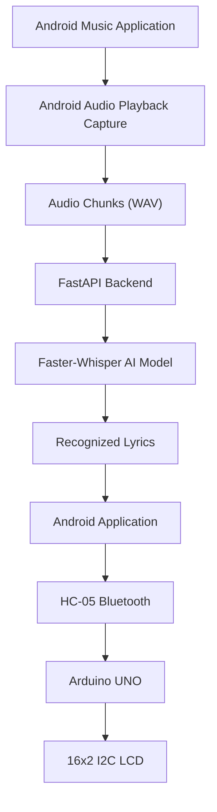

# 🎵 LiveLyrics – Real-Time AI-Powered Lyrics Recognition

**LiveLyrics** is an AI-powered Android and IoT project that captures music audio, recognizes spoken or sung lyrics using a locally running Whisper model, and displays the recognized text on a 16×2 LCD connected to an Arduino UNO through Bluetooth.

The project combines Android development, speech recognition, Python backend services, and embedded hardware to create a real-time lyrics display system.

## ✨ Features

- **Audio Playback Capture:** Captures internal audio from supported Android applications.
- **AI-Based Transcription:** Uses Faster-Whisper for local audio transcription.
- **Python Backend:** Processes audio through a FastAPI server.
- **Bluetooth Communication:** Transfers recognized lyrics from Android to Arduino using HC-05.
- **LCD Display:** Displays recognized lyrics on a 16×2 I2C LCD.
- **Local Processing:** Uses a locally hosted Whisper model instead of a paid transcription API.

## 🏗️ System Architecture



## 🛠️ Technologies Used

| Component | Technologies |
|---|---|
| Android Application | Kotlin, Jetpack Compose |
| Audio Capture | Android AudioPlaybackCapture API |
| Backend | Python, FastAPI |
| Speech Recognition | Faster-Whisper |
| Communication | HTTP, Bluetooth Serial |
| Microcontroller | Arduino UNO |
| Bluetooth Module | HC-05 |
| Display | 16×2 I2C LCD |

## 📁 Project Structure

```text
LiveLyrics/
│
├── android-app/
│   ├── app/
│   │   └── src/main/
│   │       ├── java/com/example/livelyrics/
│   │       │   ├── MainActivity.kt
│   │       │   ├── AudioCaptureManager.kt
│   │       │   └── AudioCaptureService.kt
│   │       └── AndroidManifest.xml
│   ├── build.gradle.kts
│   └── settings.gradle.kts
│
├── python-backend/
│   ├── main.py
│   ├── requirements.txt
│   └── test_transcription.py
│
├── .gitignore
└── README.md
```

## ⚙️ Hardware Requirements

- Arduino UNO
- HC-05 Bluetooth module
- 16×2 LCD with I2C interface
- 4.7kΩ resistor
- 10kΩ resistor
- Android smartphone
- Computer running the Python backend
- Connecting wires

## 🔌 Hardware Connections

### 1. LCD I2C → Arduino UNO

| LCD Pin | Arduino Pin |
|---|---|
| GND | GND |
| VCC | 5V |
| SDA | A4 |
| SCL | A5 |

### 2. HC-05 → Arduino UNO

| HC-05 Pin | Arduino Connection |
|---|---|
| VCC | 5V |
| GND | GND |
| TXD | Digital Pin 10 |
| RXD | Digital Pin 11 through a voltage divider |

**Important:** Use a voltage divider for the Arduino D11 → HC-05 RXD connection:

- Arduino D11 → 4.7kΩ resistor → junction.
- Junction → HC-05 RXD.
- Junction → 10kΩ resistor → GND.

The Arduino and Bluetooth module must share a common ground.

The Arduino code uses `SoftwareSerial(10, 11)`.

## 🚀 Installation and Setup

### 1. Clone the Repository

```bash
git clone https://github.com/adarshsr2005/LiveLyrics.git
cd LiveLyrics
```

### 2. Set Up the Python Backend

Navigate to the backend directory:

```bash
cd python-backend
```

Create a virtual environment:

```bash
python -m venv venv
```

Activate it on Windows:

```bash
venv\Scripts\activate
```

Install dependencies:

```bash
pip install -r requirements.txt
```

Start the FastAPI server:

```bash
python -m uvicorn main:app --host 0.0.0.0 --port 8000
```

The backend will be available at:

```text
http://localhost:8000
```

API documentation:

```text
http://localhost:8000/docs
```

The first run may download the Whisper model.

### 3. Configure the Android Application

1. Open Android Studio.
2. Select **Open** and choose the `android-app` folder.
3. Allow Gradle synchronization to complete.
4. Connect your Android phone or use a supported Android device.
5. Ensure the phone and computer are connected to the same Wi-Fi network.
6. Configure the Android backend URL to use your computer's current local network IP address:

```text
http://YOUR_PC_IP_ADDRESS:8000/transcribe
```

Replace `YOUR_PC_IP_ADDRESS` with your computer's Wi-Fi IPv4 address.

7. Build and run the Android application.
8. Grant the required audio capture and Bluetooth permissions.

### 4. Connect the Hardware

1. Upload the Arduino program to the UNO.
2. Connect the HC-05 Bluetooth module and LCD according to the wiring tables.
3. Pair the HC-05 with your Android phone.
4. Connect to the HC-05 from the LiveLyrics application.
5. Start audio capture and play music from an application that supports Android playback capture.

## 🔄 Working Process

1. The Android application captures internal audio from supported music applications.
2. Audio is divided into chunks and converted into WAV format.
3. The audio chunks are transmitted to the Python backend over Wi-Fi.
4. FastAPI receives the audio and passes it to Faster-Whisper.
5. Faster-Whisper generates recognized text.
6. The backend sends the transcription back to the Android application.
7. Android transfers the recognized lyrics through HC-05 Bluetooth.
8. Arduino receives the text and displays it on the 16×2 LCD.

## ⚠️ Limitations

- Android playback capture works only with applications that permit audio playback capture.
- Transcription accuracy can vary for songs because of background instruments, vocals, pronunciation, and overlapping sounds.
- Processing time depends on the computer's hardware and the Whisper model.
- Both the Android device and backend computer must be connected to the same reachable network.
- The backend must be running for transcription to work.

## 🔮 Future Enhancements

- Improve transcription accuracy for singing and background music.
- Optimize audio chunking and reduce transcription latency.
- Implement synchronized lyrics display.
- Add automatic scrolling and improved text formatting.
- Explore GPU acceleration for faster inference.
- Improve support for multiple languages.

## 👨‍💻 Developer

**Adarsh S. R.**

Computer Science and Engineering – Artificial Intelligence and Machine Learning

GitHub: [@adarshsr2005](https://github.com/adarshsr2005)

---

⭐ If you find this project interesting, consider giving the repository a star!
